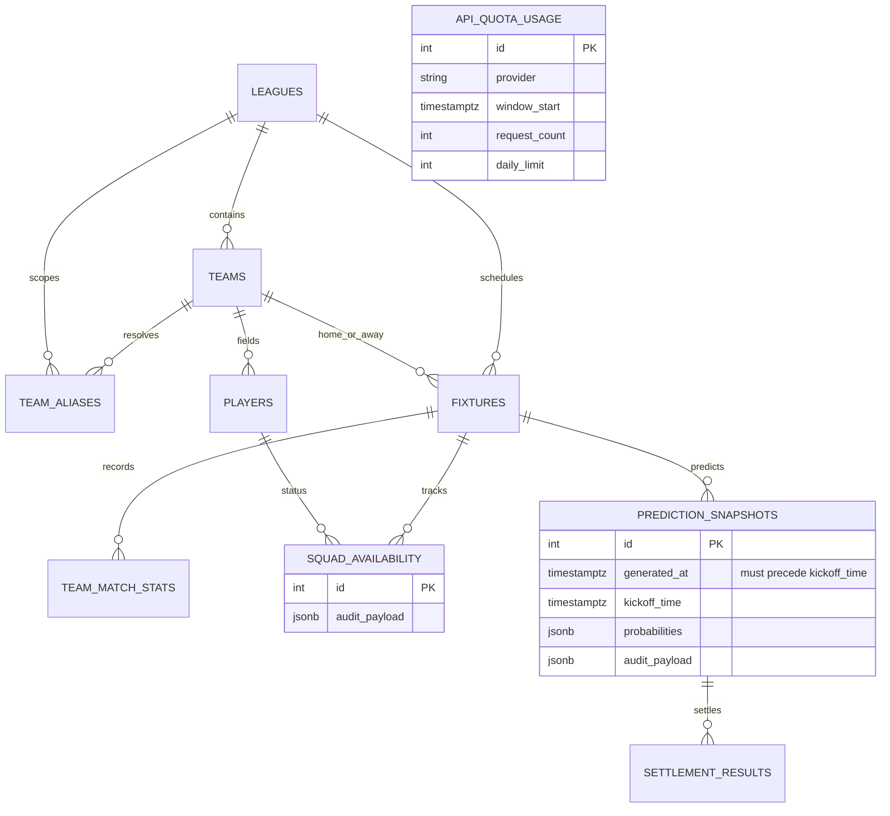

# SpikeMetrics

Pre-match football analysis with live fixture/results ingestion from football-data.org, an out-of-the-box demo dataset, probabilistic scorelines, and a React dashboard.

## Start locally

```sh
cp .env.example .env
docker compose up --build
```

Open <http://localhost:5173>. The API is at <http://localhost:8000/api/v1>; interactive docs are at <http://localhost:8000/docs>. Demo mode requires no API keys. To enable real fixtures and results, create a free [football-data.org account](https://www.football-data.org/client/register), copy its token to `FOOTBALL_DATA_TOKEN` in `.env`, then restart. The app syncs the ten configured competitions every six hours, at 6.2-second spacing, and stores normalized fixtures and results in PostgreSQL. The free plan currently provides fixtures, scores and tables for 12 competitions at 10 requests/minute; this app uses ten per sync. Confirm current coverage and limits at [football-data.org pricing](https://www.football-data.org/pricing).

API-Football is optional and currently is not used for fixture ingestion. Its current free tier lists 100 requests/day and 10 requests/minute; a key may be kept in `.env` for future lineup/injury work. Do not commit `.env` or put provider keys in frontend variables. The free football-data tier does not provide xG, so live predictions use team and competition goal averages and mark xG and lineups unavailable.

For local development, run the API from `backend` with `uvicorn app.main:app --reload`, and run the UI from `frontend` with `npm install && npm run dev`.

## Project layout

```text
backend/app/{core,models,migrations,ingestion,ratings,analysis,simulation,evaluation,api/v1}/
frontend/src/{components,pages,lib}/
docker-compose.yml
.env.example
README.md
```

## PostgreSQL entities



`team_aliases` are unique per league after normalization to make entity matches stable. Fixture and prediction instants use timezone-aware PostgreSQL timestamps. Prediction snapshots include a database check that prevents post-kickoff generation. Availability and prediction changes retain JSONB audit payloads.

## API

- `GET /api/v1/health`
- `GET /api/v1/fixtures/upcoming`
- `GET /api/v1/fixtures/{id}/prediction`
- `POST /api/v1/fixtures/{id}/simulate`
- `GET /api/v1/calibration/summary`
- `GET /api/v1/system/quotas`
- `POST /api/v1/admin/sync`

The simulator uses a Dixon–Coles corrected 0–8 score matrix and a repeatable 10,000-sample Monte Carlo cross-check. Its probabilities are model estimates, not guarantees. Inputs degrade explicitly when xG or confirmed lineups are unavailable. In local Docker mode, the initial sync begins five seconds after startup and repeats every six hours. On Vercel, the protected `GET /api/v1/admin/sync` Cron route runs once each day; a manual `POST /api/v1/admin/sync` requires `X-Admin-Token` when `ADMIN_API_TOKEN` is configured.

## Free public deployment

Vercel can host both the Vite frontend and FastAPI backend on its free Hobby plan for personal, non-commercial projects. The repository is a monorepo, so create two Vercel projects connected to the same GitHub repository:

1. Create a Neon Postgres project and copy its connection string. Before deploying, run the database migration from `backend` with the connection string: `DATABASE_URL='your-Neon-connection-string' alembic upgrade head`.
2. Create a Vercel project named `spikemetrics-api`, set its Root Directory to `backend`, and configure `DATABASE_URL`, `FOOTBALL_DATA_TOKEN`, `CRON_SECRET`, and `CORS_ORIGINS`. The Python runtime detects FastAPI from `app/main.py`; `backend/vercel.json` sets the function duration and once-daily data sync. Set `CORS_ORIGINS` to the frontend's exact Vercel origin, for example `https://spikemetrics.vercel.app`.
3. Create a second Vercel project named `spikemetrics`, connected to the same repository, with Root Directory `frontend`. Set `VITE_API_URL` to the API deployment URL plus `/api/v1`, for example `https://spikemetrics-api.vercel.app/api/v1`.
4. Add `FOOTBALL_DATA_TOKEN` to the backend project's Vercel environment variables. The optional `API_FOOTBALL_KEY` is not used by current ingestion. Do not put secrets in GitHub or frontend variables.

Vercel Cron invokes the protected `GET /api/v1/admin/sync` route daily at 04:00 UTC (Hobby timing may vary). The sync uses ten football-data.org competition requests spaced to respect the free 10 requests/minute limit. Vercel Functions are request-driven, so APScheduler runs only in local Docker mode. Vercel Hobby is free for personal, non-commercial projects; its resource limits and cron behavior can change.

## Database migrations

Alembic applies the schema automatically in the local Docker API container at startup. Vercel does not run the Docker startup command, so apply migrations to Neon before the first Vercel deployment. From `backend`, run `DATABASE_URL='your-Neon-connection-string' alembic upgrade head`; generate later revisions with `alembic revision --autogenerate -m "description"`.

## Verification

From `backend`, run `python -m pytest`. Tests cover rate limiting, pre-kickoff validation, and probability outputs.
