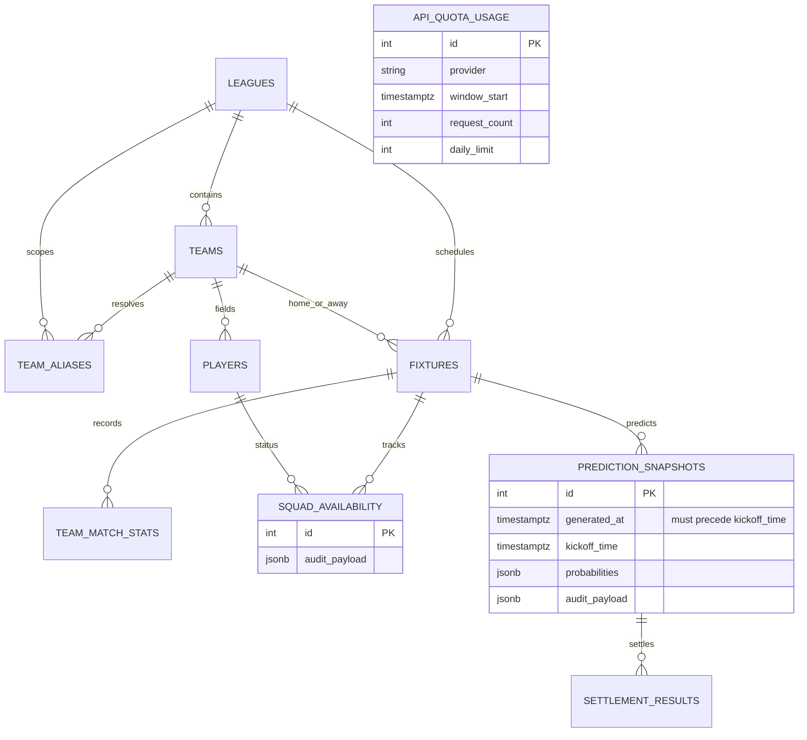

# SpikeMetrics

Pre-match football analysis with live fixture/results ingestion from football-data.org, an out-of-the-box demo dataset, probabilistic scorelines, and a React dashboard.

## Start locally

```sh
cp .env.example .env
docker compose up --build
```

Open <http://localhost:5173>. The API is at <http://localhost:8000/api/v1>; interactive docs are at <http://localhost:8000/docs>. Demo mode requires no API keys. To enable real fixtures and results, create a free [football-data.org account](https://www.football-data.org/client/register), copy its token to `FOOTBALL_DATA_TOKEN` in `.env`, then restart. The app syncs the ten configured competitions every six hours, at 6.2-second spacing, and stores normalized fixtures and results in PostgreSQL. The free plan currently provides fixtures, scores and tables for 12 competitions at 10 requests/minute; this app uses ten per sync. Confirm current coverage and limits at [football-data.org pricing](https://www.football-data.org/pricing).

API-Football is optional and currently is not used for fixture ingestion. Its current free tier lists 100 requests/day and 10 requests/minute; a key may be kept in `.env` for future lineup/injury work. Do not commit `.env` or put provider keys in frontend variables. The free football-data tier does not provide xG, so live predictions use team and competition goal averages and mark xG and lineups unavailable.

For local development, run the API from `backend` with `uvicorn app.main:app --reload`, and run the UI from `frontend` with `npm install && npm run dev`.

## Project layout

```text
backend/app/{core,models,migrations,ingestion,ratings,analysis,simulation,evaluation,api/v1}/
frontend/src/{components,pages,lib}/
docker-compose.yml
.env.example
README.md
```

## PostgreSQL entities



`team_aliases` are unique per league after normalization to make entity matches stable. Fixture and prediction instants use timezone-aware PostgreSQL timestamps. Prediction snapshots include a database check that prevents post-kickoff generation. Availability and prediction changes retain JSONB audit payloads.

## API

- `GET /api/v1/health`
- `GET /api/v1/fixtures/upcoming`
- `GET /api/v1/fixtures/{id}/prediction`
- `POST /api/v1/fixtures/{id}/simulate`
- `GET /api/v1/calibration/summary`
- `GET /api/v1/system/quotas`
- `POST /api/v1/admin/sync`

The simulator uses a Dixon–Coles corrected 0–8 score matrix and a repeatable 10,000-sample Monte Carlo cross-check. Its probabilities are model estimates, not guarantees. Inputs degrade explicitly when xG or confirmed lineups are unavailable. With a valid football-data token, the initial sync begins five seconds after startup and repeats every six hours. `POST /api/v1/admin/sync` requires `X-Admin-Token` when `ADMIN_API_TOKEN` is configured.

## Free public deployment

The public `main` branch can publish the frontend through GitHub Pages using `.github/workflows/pages.yml`. GitHub Pages serves only static files, so the API needs a separate web host. `render.yaml` prepares a free Render web service; free web instances sleep after 15 minutes idle, and free Render Postgres expires after 30 days, so use an external Postgres provider for a durable database. Neon currently lists a $0 plan with 1 GB/project and no time limit; its compute sleeps when inactive. Free plans and limits can change.

1. Create a Neon Postgres project and copy its connection string. Create a Render account and deploy this repository using the included Blueprint. Set `DATABASE_URL` to the Neon connection string, `FOOTBALL_DATA_TOKEN` to your provider token, and a private `ADMIN_API_TOKEN` in the Render service environment.
2. In GitHub repository settings, enable Pages with **GitHub Actions**. Add repository variable `VITE_API_URL` with the deployed API base, for example `https://spikemetrics-api.onrender.com/api/v1`.
3. Set Render `CORS_ORIGINS` to `https://johnmnyika.github.io` (or your actual Pages host) and push to `main` to publish the frontend. The Pages workflow stops with a clear error until `VITE_API_URL` is configured.

GitHub Pages is available for public repositories on GitHub Free. Render's free web service may take about a minute to wake after idle time; Neon free databases can also suspend compute when inactive. These options are useful for a public demo, not an uptime guarantee.

## Database migrations

Alembic applies the initial PostgreSQL schema automatically in the API container at startup. To operate it manually, from `backend` run `alembic upgrade head`; generate later revisions with `alembic revision --autogenerate -m "description"`.

## Verification

From `backend`, run `python -m pytest`. Tests cover rate limiting, pre-kickoff validation, and probability outputs.
